  
  

## `profile.sh --about`

I'm an undergraduate engineering student building practical skills across cybersecurity, digital forensics, governance, risk and compliance, and machine learning.

I care about understanding how systems fail, validating evidence, documenting risk, and building tools that make security work more reliable.

- **Cybersecurity:** Defensive security and Purple Team fundamentals
- **Digital forensics:** Autopsy, FTK Imager, artifact analysis
- **GRC:** Risk registers, security policies, control mapping
- **Machine learning:** Model evaluation, leakage checks, reproducible experiments
- **Languages:** Python, C, C++

## `profile.sh --live`

  

## `./toolbox`

  

  
  
  
  

## `./projects --featured`

### 01. Asteroid Hazard Classifier

Machine-learning experiments on near-Earth asteroid data, with a focus on class imbalance, group-aware validation, leakage checks, and reproducible evaluation.

[**Explore the repository →**](https://github.com/aditirkatare/asteroid-hazard-classifier)

### 02. Cyberdyne Systems GRC Policy Pack

A security policy pack for a fictional SaaS company, covering policies, framework mapping, evidence planning, audit testing, and implementation guidance.

[**Explore the repository →**](https://github.com/aditirkatare/cyberdyne-systems-grc-policy-pack)

### 03. Cyberdyne Systems Risk Register

A structured register of cybersecurity and business risks, with scoring, accountable owners, treatment plans, and framework mappings.

[**Explore the repository →**](https://github.com/aditirkatare/cyberdyne-systems-risk-register)

## `./telemetry`

  
  

  

**Build carefully. Verify evidence. Document everything.**

Learning in public, one commit at a time.

