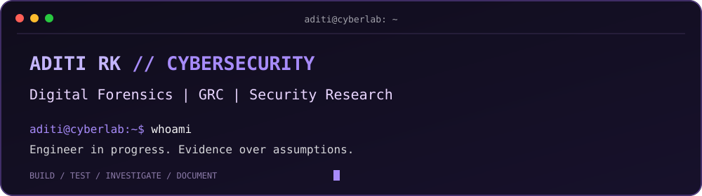
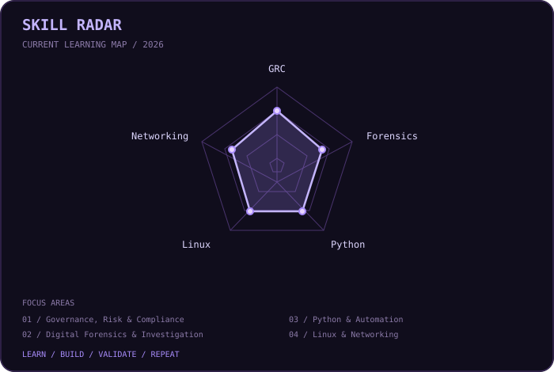
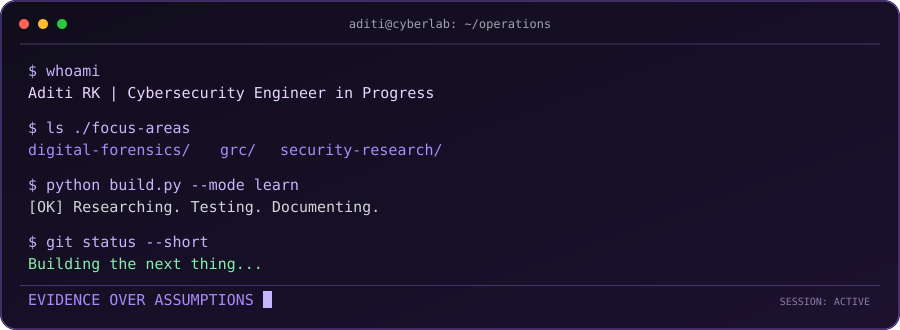
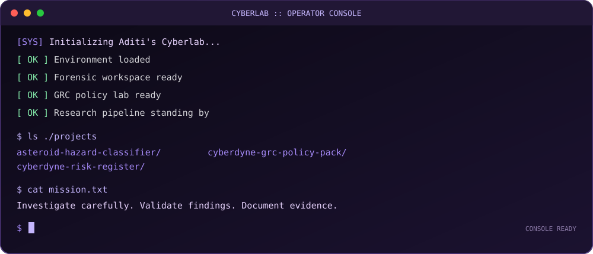

---

## `whoami`

I'm an undergraduate engineering student developing practical skills in cybersecurity, digital forensics, and governance, risk and compliance (GRC).

- 🔐 Exploring defensive security, offensive security fundamentals, and purple-team workflows in authorised labs.
- 🔎 Learning digital forensic investigation and artifact analysis.
- 🧾 Building GRC documentation and risk assessments mapped to security frameworks.
- 🧪 Exploring machine learning with an emphasis on careful validation and reproducibility.

## `toolbox`

  

**Security tools:** Kali Linux · Autopsy · FTK Imager  
**Frameworks:** NIST CSF 2.0 · CIS Controls v8.1  
**Focus areas:** Network security · Digital forensics · Risk assessment · Security controls

## `selected_projects`

### 🔬 NASA Near-Earth Object Hazard Classifier
Machine-learning experiments on asteroid hazard classification, with group-aware validation and leakage analysis.

[Explore the repository](https://github.com/aditirkatare/asteroid-hazard-classifier)

### 🛡️ Cyberdyne Systems GRC Policy Pack
Security and governance policy documentation for a fictional SaaS company.

[Explore the repository](https://github.com/aditirkatare/cyberdyne-systems-grc-policy-pack)

### 📋 Cyberdyne Systems Risk Register
Cybersecurity and business risk analysis with control mapping and risk treatment planning.

[Explore the repository](https://github.com/aditirkatare/cyberdyne-systems-risk-register)

## `github_stats`

  
  

  

<h2 align="center">⌁ Live Terminal</h2>

  

<h2 align="center">⌁ CYBERLAB // LIVE SESSION</h2>

  

  

<h2 align="center">⌁ PROJECT REGISTRY</h2>

<code>CLASSIFIED: PUBLIC REPOSITORIES // 03 PROJECTS</code>

<table>
  <tr>
    <td width="50%" valign="top">
      <h3>01 / Asteroid Hazard Classifier</h3>
      
Machine learning experiments on near-Earth asteroid hazard classification, including model evaluation and leakage checks.

      
<strong>STACK</strong> Python · Pandas · Scikit-learn

      <a href="https://github.com/aditirkatare/asteroid-hazard-classifier">[ ACCESS REPOSITORY ]</a>
    </td>
    <td width="50%" valign="top">
      <h3>02 / Cyberdyne GRC Policy Pack</h3>
      
A fictional SaaS security policy pack aligned with recognised cybersecurity and governance frameworks.

      
<strong>FOCUS</strong> GRC · NIST CSF · CIS Controls

      <a href="https://github.com/aditirkatare/cyberdyne-systems-grc-policy-pack">[ ACCESS REPOSITORY ]</a>
    </td>
  </tr>
  <tr>
    <td colspan="2" valign="top">
      <h3>03 / Cyberdyne Risk Register</h3>
      
A structured cybersecurity and business risk assessment with risk scoring, controls, ownership, treatment plans, and framework mapping.

      
<strong>FOCUS</strong> Risk Analysis · Residual Risk · SOC 2 Mapping

      <a href="https://github.com/aditirkatare/cyberdyne-systems-risk-register">[ ACCESS REPOSITORY ]</a>
    </td>
  </tr>
</table>

<code>END OF REGISTRY // EVIDENCE OVER ASSUMPTIONS</code>

<h2 align="center">⌁ CONTRIBUTION ACTIVITY</h2>

  

<h2 align="center">⌁ GitHub Telemetry</h2>

  
  

  

`Build carefully. Verify evidence. Document everything.`

